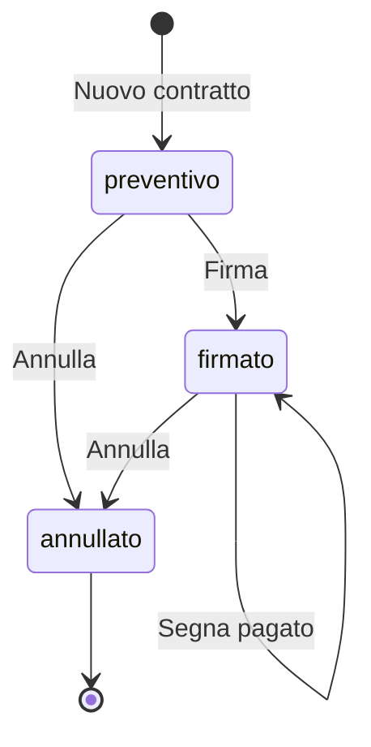
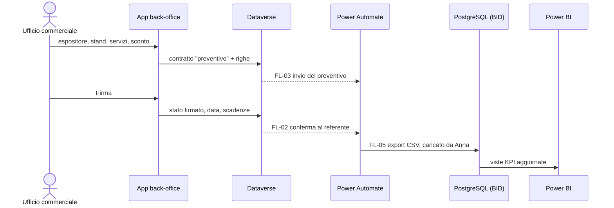

# Analisi funzionale

Analisi del progetto dal punto di vista di BAD: cosa deve fare la piattaforma, chi la usa, quali regole segue, come si integra con la parte di BID e in che ordine la costruiamo. Aggiornata al 2026-11-06.

Fonti: [progetto.md](progetto.md), [architettura.md](architettura.md), [schema-dati.md](schema-dati.md), [dati.md](dati.md), [kpi.md](kpi.md), [programma.md](programma.md), le decisioni e i dati verificati in Dataverse. Quello che non è scritto nei documenti del cliente è segnato come **proposta** e va confermato ([assunzioni](assunzioni-bad.md), [domande per il cliente](domande-cliente.md)).

## 1. Obiettivi

Il cliente chiede una piattaforma unica per:

1. **vendere meglio** spazi e sponsorizzazioni, dal preventivo al contratto, all'incasso, al rinnovo;
2. **capire i numeri** di biglietti, ingressi e visite agli stand, prima, durante e dopo la fiera.

Le sei domande della direzione e dove rispondiamo:

| Domanda | Dove |
|---|---|
| Quali padiglioni rendono di più? | Power BI, pagina Padiglioni |
| Quali espositori tornano e quali perdiamo? | Power BI, pagina Rinnovi; app, schermata Rinnovi |
| In quali giorni il pubblico compra i biglietti? | Power BI, pagina Pubblico |
| A che ora i padiglioni sono più pieni? | Power BI, pagina Affluenza; cruscotto BID |
| Quanti biglietti venduti diventano ingressi? | Power BI, pagina Pubblico |
| Come va il 2025 rispetto al 2024? | Power BI, pagina Sintesi |

Obiettivo minimo della demo finale: le tre fasi della fiera.

| Fase | Cosa si vede | BAD | BID |
|---|---|---|---|
| Prima | vendita di uno stand dal preventivo al contratto | app back-office, flussi di conferma e promemoria, Power BI | contratto in PostgreSQL |
| Durante | affluenza e visite agli stand in tempo reale | app di scansione allo stand | cruscotto staff |
| Dopo | riepilogo all'espositore, confronto tra edizioni, rinnovo | schermata Rinnovi, flusso di invito, Power BI | portale espositori |

## 2. Perimetro

| Area | BAD | BID |
|---|---|---|
| Dati commerciali (espositori, stand, listino, contratti) | gestione in Dataverse e invio a PostgreSQL | caricamento in PostgreSQL |
| Biglietteria, tornelli, storico visite e contatti | — | caricamento e pulizia |
| KPI | lettura in Power BI | calcolo nelle viste SQL |
| Interfacce | app back-office, app di scansione, flussi, Power BI | API, cruscotto staff, portale espositori |

Fuori perimetro: vendita dei biglietti, tornelli, fatturazione, pagamenti elettronici, firma digitale.

Vincoli:

- nessuna licenza premium: niente connettore PostgreSQL, niente HTTP verso le API, niente connettori personalizzati ([decisione 0005](decisioni/0005-dataverse-sincronizzato-con-postgresql.md));
- ambiente Developer: utenti da aggiungere a mano, 750 esecuzioni di flussi al mese, sospensione dal 2026-12-15 se non gestito;
- nessun dato personale su Git.

## 3. Utenti

| Utente | Cosa fa | Strumento |
|---|---|---|
| Ufficio commerciale | vende stand ed extra, segue pagamenti e scadenze, prepara i rinnovi | app back-office |
| Direzione | legge i KPI e confronta le edizioni | Power BI |
| Addetto allo stand | registra le visite allo stand durante la fiera (chi sia esattamente: domanda D15) | app di scansione |
| Referente dell'espositore | riceve preventivo, conferma, promemoria e invito al rinnovo | email dei flussi |
| Staff in fiera | guarda l'affluenza in diretta | cruscotto BID |
| Espositore | vede solo i dati del proprio stand | portale BID |

Chi fa cosa nel team: [team.md](team.md#divisione-interna-bad).

## 4. Requisiti dell'app back-office

Stato: ✅ fatto · 🟡 fatto, da provare · ⬜ da fare.

| # | Requisito | Stato |
|---|---|---|
| RF-01 | Elenco e ricerca degli espositori | ✅ |
| RF-02 | Nuovo espositore e modifica; ID `ESP` + numero progressivo; partita IVA di 11 cifre | 🟡 |
| RF-03 | Stand per edizione con padiglione, mq, posizione e stato libero/venduto | ✅ |
| RF-04 | Listino per categoria; modifica di prezzo e disponibilità | 🟡 |
| RF-05 | Nuovo contratto in 4 passi: espositore, stand libero, servizi, sconto e riepilogo | ✅ |
| RF-06 | Solo stand liberi; al salvataggio si ricontrolla che nessuno l'abbia venduto nel frattempo | ✅ |
| RF-07 | Righe e importi calcolati con le regole del §6 | ✅ |
| RF-08 | Il contratto nasce come preventivo con numero `C<anno>-<nnnn>` | ✅ |
| RF-09 | Firma: stato firmato, data di firma, scadenze di acconto e saldo | ✅ |
| RF-10 | Annulla con doppia conferma; i contratti non si cancellano | ✅ |
| RF-11 | Acconti e saldi con stato (pagato, da pagare, scaduto) e "Segna pagato" | ✅ |
| RF-12 | Sollecito via email al referente | ✅ (manuale; automatico con FL-01) |
| RF-13 | Rinnovi: espositori dell'edizione precedente con lo stand storico e "Prepara preventivo" | ✅ |
| RF-14 | Indice di rinnovo 0–3 per ordinare chi ricontattare (proposta, A13) | ✅ |
| RF-15 | Controlli sui dati in tempo reale | ✅ |
| RF-16 | Disponibilità di sponsor ed extra controllata su tutta l'edizione, non solo sul contratto | ⬜ |

Schermate e funzionamento: [power-platform.md](power-platform.md#app-back-office), [guida-app-backoffice.md](guida-app-backoffice.md).

## 5. Altri prodotti BAD

| Prodotto | Responsabili | Specifica |
|---|---|---|
| App di scansione allo stand | Alessandro, Lorenzo | [`power-platform/app-scansione/`](../../power-platform/app-scansione/README.md) |
| Flussi Power Automate | Adam | [`power-platform/power-automate/`](../../power-platform/power-automate/README.md) |
| Report Power BI | Cristian, Yenje | [`power-platform/powerbi/`](../../power-platform/powerbi/README.md) |

## 6. Regole di business

Le regole 1–7 sono state controllate su tutti i 198 contratti storici.

| # | Regola | Origine |
|---|---|---|
| 1 | Prezzo area = mq × prezzo al mq del padiglione (2026: P1 190, P2 170, P3 125 €/mq) | listino, contratti storici |
| 2 | Maggiorazione sull'area: angolo +10%, penisola +15%, isola +25% | listino, contratti storici |
| 3 | Imponibile = totale a listino × (1 − sconto); sconti 0, 5, 10, 15, 20% | contratti storici (D17) |
| 4 | Acconto 30% alla firma, scadenza firma + 15 giorni | listino |
| 5 | Saldo 70%, scadenza 30 giorni prima della fiera (2026: 18/11) | listino |
| 6 | Numero contratto progressivo su tutte le edizioni | contratti storici |
| 7 | Rinnovo = espositore presente nell'edizione precedente | contratti storici |
| 8 | Prelazione sullo stesso stand fino al 31 marzo; per il 2026 è già scaduta e si mostra solo come informazione | listino (D8) |
| 9 | Uno stand si vende una sola volta per edizione (contratti non annullati) | `schema.sql` |
| 10 | I contratti si annullano, non si cancellano | proposta BAD |
| 11 | Un contratto nasce preventivo e diventa firmato con la data di firma | proposta (A3, D16) |

Stato libero/occupato dello stand, importo dell'acconto e del saldo e stato del pagamento **non si salvano**: si calcolano.

## 7. Processi

### Ciclo di vita del contratto

### Vendita di uno stand

### Durante e dopo la fiera

- **Durante:** l'addetto registra le visite con l'app di scansione → Dataverse → PostgreSQL → cruscotto e portale BID, Power BI.
- **Dopo:** confronto tra edizioni in Power BI → schermata Rinnovi → invito al rinnovo (FL-06) → nuovo preventivo.

## 8. Integrazione con BID

Dataverse è la fonte dei dati commerciali; PostgreSQL li riceve con una sincronizzazione a senso unico; Power BI e le API leggono le stesse viste ([decisione 0005](decisioni/0005-dataverse-sincronizzato-con-postgresql.md), [mappatura](mappatura-dataverse.md)).

| Opzione | Come | Quando |
|---|---|---|
| B. Export e caricamento | FL-05 (o export manuale) produce i CSV nel formato di [`power-platform/README.md`](../../power-platform/README.md); Anna li carica con lo importatore `db/caricamento/importa_commerciale.py` | per il SAL del 4/12 |
| A. Lettura dalla Web API | job Spring Boot che legge le righe cambiate (change tracking già attivo) | dopo, se si ottiene la registrazione di un'app in Microsoft Entra ID |

Il formato dei file è lo stesso nei due casi, così il caricamento di Anna non cambia.

Punti da concordare:

| # | Tema | Chi | Entro |
|---|---|---|---|
| S-01 | Opzione B per il SAL | Alessandro, Anna, Yassin | 2026-11-09 |
| S-02 | Intestazioni dei CSV e cartella condivisa | Alessandro, Anna | 2026-11-09 |
| S-03 | Caricamento commerciale in PostgreSQL, ripetibile (upsert sui codici), annullati compresi | Anna | 2026-11-12 |
| S-04 | C2026-0200 in PostgreSQL e in Power BI | Alessandro, Anna, Cristian, Yenje | 2026-11-12 |
| S-05 | Parametri di `bad_powerbi` | Anna | 2026-11-09 |
| S-06 | Viste mancanti per Power BI | Anna, Cristian, Yenje | 2026-11-16 |
| S-07 | Chiave stabile per le scansioni dell'app | Anna, Alessandro, Lorenzo | 2026-11-16 |
| S-08 | Tempo reale nella demo (opzione A, export frequente o simulazione) | Anna, Yassin, Daniel, Alessandro | 2026-11-20 |
| S-09 | Stessi numeri in Power BI e nel web | Anna, Cristian, Yenje, Daniel | 2026-12-01 |
| S-10 | Conferma delle assunzioni A1–A15 | Anna | 2026-11-09 |
| S-11 | Utenti BID nell'ambiente Power Platform | Alessandro | 2026-11-09 |

## 9. Requisiti non funzionali

| Requisito | Come lo rispettiamo |
|---|---|
| I numeri tornano tra le viste | KPI solo nelle viste SQL; Dataverse unica fonte dei dati commerciali |
| Anomalie trovate e gestite | controlli nell'app, flusso FL-04, registro anomalie di BID |
| Riservatezza tra espositori | filtro lato server nelle API; nessun dato di altri espositori nelle email |
| Tutela dei minori | solo dati aggregati; nessun dato personale nelle scansioni |
| Dati personali | `power-platform/data/` fuori da Git |
| Ripetibilità | soluzione esportata nel repository, app generata da codice, caricamenti in upsert |

## 10. Piano

| Data | Milestone | BAD |
|---|---|---|
| 2026-10-30 | SAL 1 | accordo su Dataverse e sincronizzazione ✅ |
| 2026-11-03/04 | — | tabelle, dati, app back-office ✅ |
| 2026-11-06 | Stato di avanzamento | documentazione, presentazione |
| 2026-11-09 | Nuova data | il SAL del 13/11 è spostato al 2026-12-04 ([programma](programma.md), [piano BAD](piano-bad.md)) |
| 2026-11-16 → 2026-11-27 | Lavoro autonomo | app di scansione, flussi, pagine Power BI |
| 2026-11-30 → 2026-12-03 | — | verifica dei numeri, export finale, prova generale |
| **2026-12-04** | **Finale** | demo prima / durante / dopo |

Attività per persona: [Gantt](../piano/gantt-arcade.html) e [todo.md](todo.md).

## 11. Rischi

| Rischio | Cosa facciamo |
|---|---|
| Connettore Dataverse dei flussi non utilizzabile | prova con il primo flusso; in alternativa flussi avviati dall'app |
| Limite di 750 esecuzioni di flussi al mese | trigger filtrati sulle colonne, export ogni 6 ore |
| `bad_powerbi` o viste mancanti in ritardo | si parte dalle pagine che usano le viste esistenti |
| Scansioni non in diretta con l'export manuale | opzione A o simulazione per la demo |
| Sospensione dell'ambiente dal 2026-12-15 | export finale della soluzione e dei dati |
| Utenti BID non aggiunti all'ambiente | condividere l'app con un ruolo; se serve, tutor |

## 12. Criteri di accettazione

**SAL del 4/12, parte commerciale:** conteggi 3 / 3 / 135 / 130 / 20 / 198 / 950 in Dataverse; C2026-0200 venduto dall'app, presente in PostgreSQL con le stesse righe e lo stesso imponibile, visibile nella pagina Vendite 2026 di Power BI.

**Finale:**

| Fase | Demo |
|---|---|
| Prima | nuovo preventivo → email del preventivo → firma → conferma → contratto in Power BI |
| Durante | scansioni allo stand → visite nel cruscotto e nel portale → curva delle presenze |
| Dopo | confronto 2024/2025/2026 → espositori persi e tornati → invito al rinnovo → nuovo preventivo |
