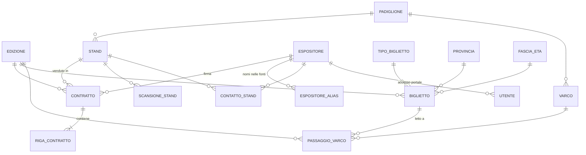

# Schema dati

Stato: **bozza**, da discutere con BAD e congelare al SAL 1 (2026-10-30). Vedi [decisione 0004](decisioni/0004-modello-dati.md).

File SQL in `db/`:

| File | Contenuto |
|---|---|
| [`db/schema.sql`](../../db/schema.sql) | Tabelle, vincoli, indici |
| [`db/dati_base.sql`](../../db/dati_base.sql) | Edizioni, padiglioni, varchi, tipi biglietto, province, fasce d'età, parametri, tabelle di decodifica |
| [`db/viste_kpi.sql`](../../db/viste_kpi.sql) | Viste dei KPI e viste per il portale espositori |

> Gli script non sono ancora stati provati su un PostgreSQL vero: vanno eseguiti e corretti appena il DB è installato.

## Diagramma

## Le tabelle in breve

### Dimensioni
| Tabella | Chiave | Note |
|---|---|---|
| `edizione` | anno | Date e orari della fiera (2024, 2025, 2026) |
| `padiglione` | codice (P1-P3) | |
| `stand` | codice_stand | mq, posizione, `attivo_dal` |
| `espositore` | id_espositore | Anagrafica, partita IVA unica |
| `voce_listino` | edizione + codice | Listino per edizione (abbiamo solo il 2026) |
| `tipo_biglietto` | codice | Tipo unico tra le edizioni, con persone e giorni |
| `provincia`, `fascia_eta` | sigla / codice | `fascia_eta.minorenne` serve per la tutela dei minori |
| `varco` | codice | Collegato al padiglione |

### Fatti
| Tabella | Una riga è | Chi la alimenta |
|---|---|---|
| `contratto` + `riga_contratto` | un contratto e le sue voci | BAD (storico da Excel, 2026 da Power Apps) |
| `biglietto` | un biglietto venduto | BID (CSV biglietteria) |
| `passaggio_varco` | una lettura al tornello | BID (CSV tornelli; in diretta per il 2026) |
| `scansione_stand` | N scansioni a uno stand in un istante | BID (storico orario 2025) e app di scansione BAD (2026) |
| `contatto_stand` | un contatto raccolto allo stand | BID (CSV) e app di scansione BAD |

### Decodifica e qualità
| Tabella | A cosa serve |
|---|---|
| `espositore_alias` | Ragione sociale scritta nei contratti → espositore (A16, A17) |
| `tipo_biglietto_alias` | Nome del tipo per edizione → tipo unico (A9) |
| `provincia_alias` | Sigla o nome maiuscolo → sigla (A10) |
| `varco_alias` | Nome del varco nelle fonti → codice (A3) |
| `anomalia` | Registro di tutte le anomalie trovate nel caricamento |
| `parametro` | Assunzioni dei KPI modificabili senza toccare il codice (permanenza, doppia lettura) |
| `utente` | Accesso alle interfacce; un utente `ESPOSITORE` è sempre legato alla sua azienda |

## Scelte principali

- **Due livelli**: i CSV si caricano prima in tabelle "grezze" (staging, da definire con l'ETL), poi nelle tabelle pulite qui sopra. Così il dato originale resta e la pulizia è ripetibile.
- **Le anomalie non si cancellano**: le righe dubbie si caricano con un flag (`passaggio_varco.anomalia`, `scansione_stand.anomalia`) e si escludono nei conteggi. Il campo calcolato `passaggio_varco.valido` dice se un passaggio conta.
- **Orari sempre con fuso** (`timestamptz`): risolve la differenza ora locale / UTC tra i tornelli 2024 e 2025.
- **Una tabella di scansioni per storico e diretta**: lo storico 2025 è aggregato per ora, l'app 2026 manderà scansioni singole. Il campo `quantita` copre entrambi i casi.
- **Uno stand venduto una sola volta per edizione**: indice unico su (edizione, stand) per i contratti non annullati.
- **Contratti con stato** (`preventivo`, `firmato`, `annullato`): serve per la fase "prima", dal preventivo al contratto.
- **Privacy nel DB, non solo nell'interfaccia**: la vista `v_contatti_espositore` mostra l'email solo con consenso e solo per i maggiorenni.

## Punti aperti

- [ ] Struttura delle tabelle di staging e script di caricamento
- [ ] Come BAD scrive i contratti 2026 (API o Power Automate): potrebbe richiedere campi in più (es. prelazione, solleciti)
- [ ] Sponsorizzazioni senza stand: oggi ogni contratto ha uno stand, va confermato
- [ ] Listini 2024 e 2025: non li abbiamo, i prezzi storici sono solo nelle righe dei contratti
