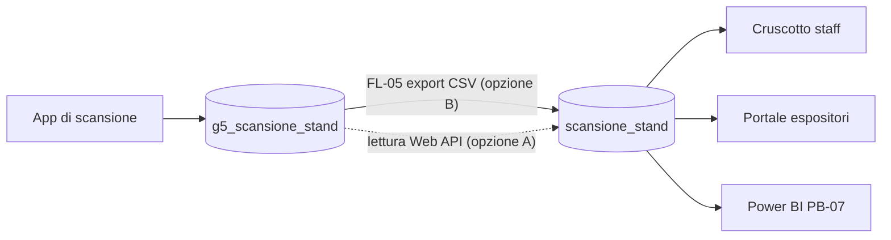

# App di scansione allo stand

Responsabili: **Alessandro Terlingo** e **Lorenzo Musto**. Consultati: Anna (tabella `scansione_stand` e caricamento), Daniel (cruscotto e portale che mostrano le visite).

Stato: **da fare**. Qui c'è l'analisi: a cosa serve l'app, come è fatta, quali tabelle e dati mancano, come arriva a BID e in che ordine la costruiamo.

## 1. A cosa serve

Nel brief gli espositori "chiedono quanta gente è passata dal loro stand e non si sa rispondere". Il documento di progetto assegna a BAD l'**app di scansione allo stand** ([team.md](../../docs/wiki/team.md)). È il prodotto BAD della fase **"durante"** della demo.

L'app registra **le visite a uno stand** mentre la fiera è aperta. Le visite arrivano in PostgreSQL nella tabella `scansione_stand` e da lì:

- nel **cruscotto staff** di BID (visite in diretta);
- nel **portale espositori** di BID (ogni espositore vede solo le proprie);
- in **Power BI** (pagina PB-07 Stand e contatti) e nel KPI **costo per contatto**.

Per il 2025 abbiamo solo lo storico aggregato per ora (`visite_stand_2025.csv`, 35.301 visite valide). Per il 2026 l'app registra le visite **una per una**: `quantita = 1`, `origine = 'app'`, come previsto da `schema.sql`.

## 2. Chi la usa

Da confermare con il cliente (domanda D15). Le due possibilità:

| Utente | Pro | Contro |
|---|---|---|
| **Staff del festival** allo stand | un account per persona, controllato da noi | serve una persona per ogni stand |
| **Espositore** (un account per stand) | è lui che ha interesse a contare | 110+ account da creare e gestire; deve vedere **solo il proprio stand** |

Proposta per la demo: staff del festival, che sceglie lo stand dal QR code esposto allo stand.

## 3. Cosa si registra

| Modo | Come | Cosa si salva | Proposta |
|---|---|---|---|
| **A. Conteggio** | l'addetto tocca "+1" a ogni visitatore | stand, edizione, data e ora | **base**: semplice e senza dati personali |
| **B. Lettura del biglietto** | l'addetto inquadra il codice del biglietto con il lettore di codici a barre dell'app | come A. Il codice del biglietto **non si salva** | dopo, se il cliente lo chiede |
| **C. Contatto (lead)** | il visitatore lascia email, fascia d'età, provincia, interesse e consenso | una riga di `contatto_stand` | solo se il cliente lo chiede (domanda D7) |

Perché non salviamo il codice del biglietto: dal biglietto si risale a età e provincia del titolare, spesso un minore (anomalia A31 in [dati.md](../../docs/wiki/dati.md)). Per contare le visite non serve.

Per il modo C valgono le regole già decise da BID: un consenso vuoto vale "no" (A29); per i 14–17 anni l'email non è mai visibile all'espositore (A28). La vista `v_contatti_espositore` le applica già.

## 4. Schermate

Formato **telefono, verticale**. Nomi con il prefisso `scr` come nel back-office.

| Schermata | Contenuto |
|---|---|
| `scrScegliStand` | edizione in corso; elenco degli stand **venduti** nell'edizione (contratti firmati), con ricerca per codice o ragione sociale; in alternativa lettura del QR code dello stand |
| `scrConta` | codice dello stand e nome dell'espositore in alto; un grande pulsante **"+1 visita"**; contatore delle visite di oggi e dell'ultima ora; ultimo salvataggio riuscito; pulsante "Annulla ultima" (entro 30 secondi) |
| `scrRiepilogo` | visite di oggi per ora (grafico a barre), totale della fiera per lo stand |
| `scrContatto` (solo modo C) | modulo con email, fascia d'età, provincia, interesse, consenso; se la fascia è 14–17 il consenso non abilita l'email |

Regole dell'app:

- si possono scegliere solo gli stand con un contratto **firmato** nell'edizione in corso;
- l'ora la mette l'app (`Now()`), l'utente non la scrive;
- ogni tocco crea **una riga**. "Annulla ultima" la elimina solo entro 30 secondi; dopo, una correzione va chiesta allo staff (in Dataverse resta traccia).

## 5. Tabelle e dati da aggiungere

### 5.1 Nuova tabella `g5_scansione_stand` (obbligatoria)

Corrisponde a `scansione_stand` di [`schema.sql`](../../db/schema.sql). Va aggiunta alla soluzione ARCADE BAD e alla [specifica](../../docs/wiki/schema-dataverse.md).

| Colonna Dataverse | Tipo | Obbligatoria | PostgreSQL | Note |
|---|---|---|---|---|
| `g5_id_scansione` (primaria) | testo, max 36 | sì | `g5_id_scansione uuid` | generata dall'app con `GUID()` al momento del tocco e mai più cambiata; serve per non duplicare le righe quando si sincronizza |
| `g5_edizione` | lookup → `g5_edizione` | sì | `edizione` | anno |
| `g5_stand` | lookup → `g5_stand` | sì | `codice_stand` | codice dello stand |
| `g5_rilevato_il` | data e ora (comportamento *Ora locale utente*, salvata in UTC) | sì | `rilevato_il timestamptz` | nell'export in formato ISO 8601 con `Z` |
| `g5_quantita` | numero intero, min 0, max 1000 | sì | `quantita` | sempre 1 dall'app |
| `g5_origine` | testo, max 20 | sì | `origine` | sempre `app` |

Chiave alternativa: `g5_key_scansione_stand` = (`g5_id_scansione`). Relazioni N:1 verso edizione e stand con eliminazione *Restrict*, come le altre tabelle. Change tracking attivo. Tabella **di proprietà dell'utente** (le altre sono dell'organizzazione): serve perché il ruolo ARCADE Scansione possa eliminare solo le righe create da chi scansiona (§5.3). La proprietà non si cambia dopo la creazione.

**Chiave con BID (S-07): decisa.** Anna ha aggiunto a `scansione_stand` la colonna `g5_id_scansione uuid` univoca (soluzione 1) e l'importatore `importa_scansioni.py` ([import-scansioni.md](../../docs/wiki/import-scansioni.md)). Il CSV ha le colonne `g5_id_scansione,edizione,codice_stand,rilevato_il`.

### 5.1.1 Correzione della tabella dell'export 1.0.0.5

Nell'export 1.0.0.5 la tabella `g5_scansione_stand` esiste ma è incompleta: ha solo la colonna primaria, che si chiama `g5_g5_id_scansione` (il prefisso `g5_` è stato scritto a mano e Dataverse l'ha aggiunto una seconda volta), e nessuna chiave. Il nome logico di una colonna non si può cambiare e la colonna primaria non si può eliminare, quindi la tabella **si elimina e si ricrea**. È vuota e nessun flusso o app la usa: l'eliminazione non ha effetti su altro.

Si ricrea con un **file di soluzione generato**, come le prime sette tabelle: la definizione sta nel codice ([`genera_scansione.py`](../solution-src/genera_scansione.py)) e si può rileggere e rigenerare. Il file è una **soluzione separata**, `ARCADEBADScansione`, che contiene solo questa tabella: reimportare ARCADE BAD intera sovrascriverebbe app e flussi con la versione dello zip, e si perderebbero le modifiche salvate nell'ambiente dopo l'export.

1. Generare il file: dalla cartella `power-platform/solution-src`, `python -I genera_scansione.py` → `solution-build/ARCADEBADScansione_1_0_0_0.zip`.
2. make.powerapps.com → ambiente ARCADE-Milano-BAD-G5 → Tabelle → *Scansione stand* → Elimina tabella. Attendere la fine dell'eliminazione: finché la tabella vecchia esiste, l'import non può creare quella nuova con lo stesso nome.
3. Soluzioni → Importa soluzione → `ARCADEBADScansione_1_0_0_0.zip`. Al termine, in Tabelle compare *Scansione stand* con le sei colonne e, in Chiavi, *g5_key_scansione_stand* (attendere lo stato *Attivo*).
4. Soluzioni → ARCADE BAD → Aggiungi esistente → Tabella → *Scansione stand* (con tutti i componenti). Da qui la tabella si esporta con ARCADE BAD.
5. Soluzioni → `ARCADE BAD scansioni` → Elimina: si elimina solo il contenitore della soluzione, la tabella resta perché non è gestita.
6. Esportare ARCADE BAD (1.0.0.6), scompattarla, rimettere i segnaposto alle variabili con email e rigenerare l'inventario: in [inventario-dataverse.md](../../docs/wiki/inventario-dataverse.md) devono comparire `g5_id_scansione` (primaria, max 36), `g5_edizione`, `g5_stand`, `g5_rilevato_il`, `g5_quantita`, `g5_origine`, la chiave e le due relazioni *Restrict*.

Se l'import al punto 3 fallisce, il messaggio di errore si salva (Scarica file di log) e la tabella si crea a mano con gli stessi nomi, scrivendoli **senza** `g5_` perché il prefisso lo aggiunge Dataverse.

### 5.2 Nuova tabella `g5_contatto_stand` (solo con il modo C)

Corrisponde a `contatto_stand`: `id_contatto`, edizione, stand, espositore, `raccolto_il`, email (dato personale), fascia d'età, provincia, `consenso_marketing` (sì/no, predefinito no), interesse. Fascia d'età e provincia usano i codici delle tabelle di decodifica di BID (`fascia_eta`, `provincia`). Si decide solo dopo la risposta a D7.

### 5.3 Ruolo di sicurezza `ARCADE Scansione`

| Tabella | Permessi |
|---|---|
| `g5_scansione_stand` | Creazione e Lettura; Eliminazione solo sui propri record |
| `g5_stand`, `g5_edizione`, `g5_padiglione` | Lettura |
| `g5_contratto` | Lettura (serve per sapere quali stand sono venduti) |
| `g5_espositore` | Lettura, solo per mostrare la ragione sociale |
| `g5_riga_contratto`, `g5_voce_listino` | nessuno |

Se l'app la usano gli espositori, ognuno deve vedere solo il proprio stand. Serve una tabella di assegnazione utente → stand e un ruolo che filtra sui record, da progettare solo se il cliente sceglie questa strada.

## 6. Come le visite arrivano a BID

- Lo stesso export dei dati commerciali (flusso [FL-05](../power-automate/README.md#fl-05-export-dei-dati-commerciali-per-postgresql)) aggiunge il file `scansione_stand.csv`.
- **Volume:** nel 2025 le visite agli stand sono state circa 35.000 in tre giorni. Una riga per visita sono decine di migliaia di righe per edizione: Dataverse (2 GB) le regge, ma in FL-05 va attivata la **paginazione** di *Elenca righe* (oltre 5.000 righe).
- **Tempo reale:** con l'export ogni 6 ore il cruscotto non è in diretta. Per la demo le strade sono tre, da decidere con BID (S-08):
  1. export più frequente nel giorno della demo (attenzione al limite di 750 esecuzioni di flussi al mese);
  2. sincronizzazione automatica (opzione A), se si ottiene la registrazione dell'app;
  3. simulazione delle scansioni che Anna ha in programma, con l'app usata dal vivo per mostrare la registrazione e l'export lanciato a mano.
- **Nessun flusso a ogni tocco:** un flusso per ogni scansione esaurirebbe il limite in poche ore.

## 7. Rischi

| Rischio | Cosa facciamo |
|---|---|
| Rete assente o debole in fiera | per la demo si usa la rete della scuola; l'app mostra l'ultimo salvataggio riuscito, così chi conta se ne accorge. La modalità offline delle app Canvas è da valutare dopo |
| Doppi tocchi | "Annulla ultima" entro 30 secondi; nel caricamento BID può applicare la stessa logica delle doppie letture ai varchi (A7) |
| Stand senza scanner, come i 26 stand del 2025 senza dati (D13) | il riepilogo per stand mostra subito chi non sta registrando |
| Schema di BID da modificare per la chiave | si decide con Anna prima di creare la tabella |

## 8. Piano

| # | Attività | Chi | Entro |
|---|---|---|---|
| 1 | Risposta del cliente su D15 (chi usa l'app) e D7 (contatti) | Alessandro | 2026-11-20 |
| 2 | Accordo con Anna sulla chiave di `scansione_stand` | Alessandro, Anna | 2026-11-16 |
| 3 | Tabella `g5_scansione_stand` nella specifica e nella soluzione; ruolo ARCADE Scansione | Alessandro | 2026-11-17 |
| 4 | Schermate `scrScegliStand`, `scrConta`, `scrRiepilogo` | Lorenzo | 2026-11-20 |
| 5 | Prove su telefono, con due persone sullo stesso stand | Lorenzo | 2026-11-24 |
| 6 | `scansione_stand.csv` nell'export FL-05 e prova di caricamento con Anna | Alessandro, Adam, Anna | 2026-11-25 |
| 7 | Prova della demo "durante" con cruscotto e portale | Alessandro, Lorenzo, Daniel | 2026-12-03 |

## 9. Criteri di accettazione

- Da un telefono si sceglie uno stand venduto e si registrano 10 visite: in Dataverse ci sono 10 righe con stand, edizione, ora e `origine = app`.
- Dopo l'export e il caricamento di Anna le stesse 10 righe sono in `scansione_stand`. Un secondo caricamento non le duplica.
- Le visite compaiono nel cruscotto, nel portale (solo per quell'espositore) e nella pagina PB-07 di Power BI.
- Nessun dato personale del visitatore è salvato con le visite.
